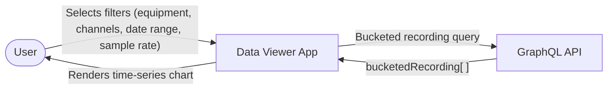
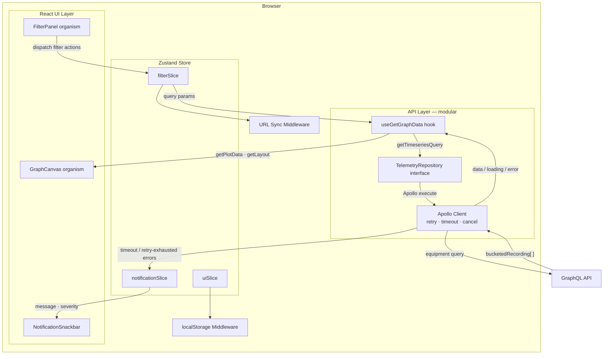
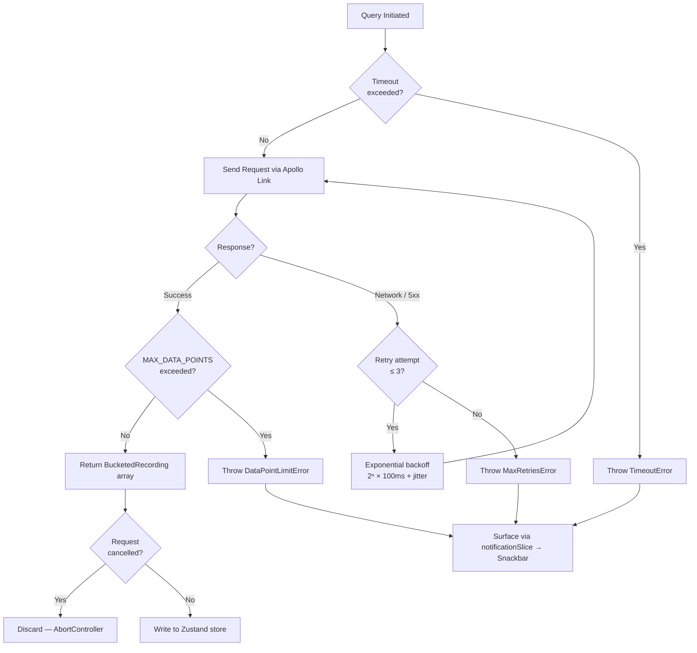
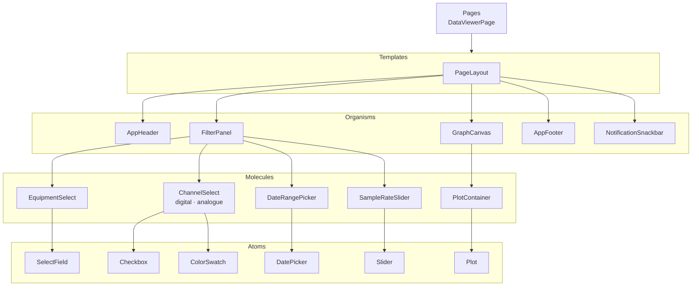
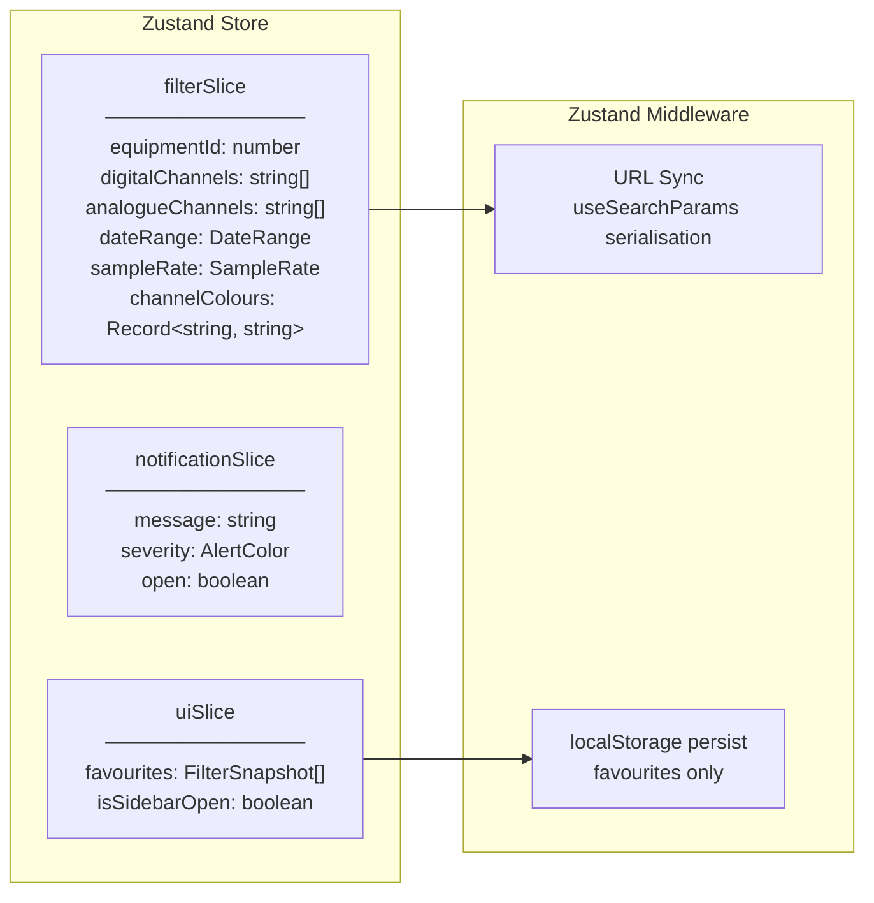
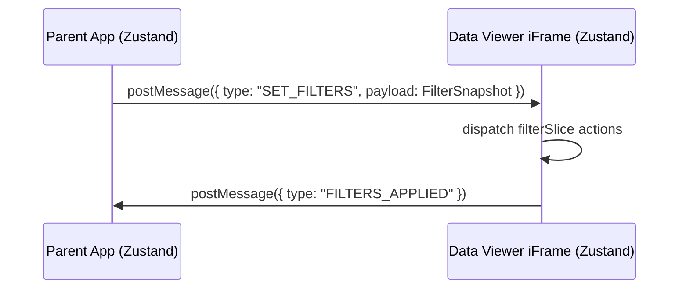

# Data Viewer
*Specification for the data viewer application*

## Requirements

### Functional Requirements

- Visualise telemetry data from equipment using interactive Plotly charts
- Filter data by equipment (required, single select), digital channels, analogue channels, date range, and sample rate
- Display digital and analogue channels in separate groups within the filter panel
- Enforce a minimum of one selected channel from either group; cap the combined total at 8 channels
- Assign a unique colour to each channel, reflected in the plot legend
- Enforce a configurable `MAX_DATA_POINTS` limit (env var, default 800,000) across all active channels
- Allow users to share plot configuration via URL and save favourite configurations
- Surface user notifications via MUI Snackbar anchored to the bottom-right corner
- Support embedding within a parent application via iFrame
- Deliver a high-fidelity interactive prototype based on this architecture and implementation plan

### Non-Functional Requirements

- API communication layer must be modular to support future migration to REST with no component changes
- Apollo Client must handle timeouts, errors, retries with exponential backoff, and request cancellation
- Full TypeScript strict-mode type safety across all layers
- 100% line, branch, and function coverage enforced by Vitest
- All linting and formatting enforced by Biome.js

---

## Tech Stack

| Concern | Technology | Version |
|---|---|---|
| UI Framework | React | 19 |
| Build Tool | Vite | 6 |
| Component Library | MUI | 9 |
| GraphQL Client | Apollo Client | 4 |
| Charting | React-Plotly | 3.1 |
| State Management | Zustand | latest |
| Type Checking | TypeScript | strict |
| Testing | Vitest | latest |
| Linting & Formatting | Biome.js | latest |
| GQL Type Generation | graphql-codegen | latest |

---

## Data Flow

### Level 0 Data Flow



### Level 1 Data Flow



---

## API Communication

The API layer is encapsulated behind a typed repository interface so that swapping Apollo for a REST client requires only a new adapter — no component or hook changes are needed.

### Repository Interface

```typescript
// src/api/TelemetryRepository.ts
interface TimeseriesQueryParams {
    equipmentId: number;
    channels: string[];
    startDate: string;
    endDate: string;
    bucketSize: number; // maps directly to sample rate
}

interface BucketedRecording {
    channel: string;
    value: number;
    timestamp: string;
}

interface TelemetryRepository {
    getTimeseries(params: TimeseriesQueryParams): Promise<BucketedRecording[]>;
}
```

### GraphQL Query

`bucketSize` maps directly to the sample rate value selected in the filter panel.

```graphql
query GetBucketedTelemetry(
    $identifiers: [Int!]!
    $startDate: String!
    $endDate: String!
    $channels: [String!]!
    $bucketSize: Int!
) {
    equipment(identifiers: $identifiers) {
        metric(
            startDate: $startDate
            endDate: $endDate
            channels: $channels
        ) {
            recording {
                bucketedRecording(bucketSize: $bucketSize) {
                    channel
                    value
                    timestamp
                }
            }
        }
    }
}
```

### Response Shape

```json
{
    "data": {
        "equipment": [
            {
                "metric": {
                    "recording": {
                        "bucketedRecording": [
                            {
                                "channel": "1",
                                "value": 10,
                                "timestamp": "2024-06-01T12:00:00"
                            }
                        ]
                    }
                }
            }
        ]
    }
}
```

### Client Resilience



### MAX_DATA_POINTS Guard Logic

`MAX_DATA_POINTS` is read from environment and defaults to `800000`.

For Vite client runtime, expose this as `VITE_MAX_DATA_POINTS` and map deployment-level `MAX_DATA_POINTS` to that value during build/deploy.

Pre-flight estimate:

$$
estimatedPoints = selectedChannelCount \times \left\lceil \frac{endDate - startDate}{bucketSizeMs} \right\rceil
$$

Guard policy:

- If `estimatedPoints > MAX_DATA_POINTS`, block the query and raise a Snackbar warning
- After response, hard-check the actual returned point count and discard if above limit
- On sample-rate or date-range changes, cancel in-flight query before issuing a new one

### Apollo Link Chain

```
ApolloClient
  └─ RetryLink        (max 3, exponential backoff with jitter)
  └─ TimeoutLink      (configurable per query, default 30s)
  └─ ErrorLink        (parse network/GraphQL errors → notificationSlice)
  └─ HttpLink         (AbortController per request for cancellation)
```

Request cancellation policy: every filter change creates a new request scope; any active scope is aborted before the next request starts.

---

## User Interface

### Wireframes

```
┌──────────────────────────────────────────────────────────────────────┐
│                             HEADER                                    │
├─────────────────────┬────────────────────────────────────────────────┤
│                     │                                                  │
│   FILTER PANEL      │                                                  │
│   (~20% width)      │           GRAPH CANVAS                          │
│                     │           (~80% width)                           │
│  ┌───────────────┐  │                                                  │
│  │ Equipment *   │  │   ╔════════════════════════════════════════╗    │
│  └───────────────┘  │   ║                                        ║    │
│                     │   ║          Plotly Chart                  ║    │
│  Digital Channels   │   ║    (time-series, multi-channel)        ║    │
│  ┌───────────────┐  │   ║                                        ║    │
│  │ □ Ch 1  ████  │  │   ╚════════════════════════════════════════╝    │
│  │ □ Ch 2  ████  │  │                                                  │
│  └───────────────┘  │                                                  │
│                     │                                                  │
│  Analogue Channels  │                                                  │
│  ┌───────────────┐  │                                                  │
│  │ □ Ch A  ████  │  │                                                  │
│  └───────────────┘  │                                                  │
│                     │                                                  │
│  Date Range         │                                                  │
│  From: [__________] │                                                  │
│  To:   [__________] │                                                  │
│                     │                                                  │
│  Sample Rate        │                                                  │
│  1─2─5─10─15─30     │                                                  │
│  [●────────────]    │                                                  │
│                     │                                                  │
├─────────────────────┴────────────────────────────────────────────────┤
│                             FOOTER                                    │
└──────────────────────────────────────────────────────────────────────┘
                                              ┌───────────────────────┐
                                              │  ✓ Snackbar (BR)      │
                                              └───────────────────────┘
```

### Design Pattern

Atomic Design is applied across the full component hierarchy:



### Component Library

#### Components

**Atoms**

| Component | MUI Base | Purpose |
|---|---|---|
| `SelectField` | `Select` | Reusable labelled select input |
| `Checkbox` | `Checkbox` | Channel selection toggle |
| `ColorSwatch` | `Box` | Solid colour block for channel legend indicator |
| `DatePicker` | `DatePicker` | Single date input |
| `Slider` | `Slider` | Stepped numeric input |
| `Plot` | — | Thin react-plotly.js wrapper |

**Molecules**

| Component | Purpose |
|---|---|
| `EquipmentSelect` | Required single-select equipment dropdown; blocks query until populated |
| `ChannelSelect` | Digital or analogue channel list; enforces 8-channel combined cap; assigns colours |
| `DateRangePicker` | From / to pair of `DatePicker` atoms with start ≤ end validation |
| `SampleRateSlider` | `Slider` restricted to marks: `1, 2, 5, 10, 15, 30` |
| `PlotContainer` | Full-height responsive Plotly chart with colour-keyed legend |

**Organisms**

| Component | Purpose |
|---|---|
| `AppHeader` | Application title bar and global actions |
| `FilterPanel` | Left drawer (~20%) composing all filter molecules |
| `GraphCanvas` | Right pane (~80%) rendering `PlotContainer` |
| `AppFooter` | Application footer |
| `NotificationSnackbar` | MUI `Snackbar` anchored bottom-right; driven by `notificationSlice` |

**Templates**

| Component | Purpose |
|---|---|
| `PageLayout` | Composes Header + FilterPanel + GraphCanvas + Footer + Snackbar in the app shell |

#### Theme Implementation

MUI 9 semantic tokens are provided via a custom `ThemeProvider` using the context/provider pattern:

```tsx
// src/theme/ThemeProvider.tsx
export const AppThemeProvider = ({ children }: PropsWithChildren) => (
    <ThemeProvider theme={appTheme}>
        <CssBaseline />
        {children}
    </ThemeProvider>
);
```

Semantic token categories:

| Category | Tokens |
|---|---|
| Colour | `primary`, `secondary`, `error`, `warning`, `info`, `success`, surface/background variants |
| Typography | `display`, `heading`, `body`, `label`, `caption` scale |
| Spacing | Base-4 scale (`xs` → `xxl`) |
| Shape | `none`, `sm`, `md`, `lg`, `full` border radius |

### Hooks

| Hook / Utility | Responsibility | Resides In |
|---|---|---|
| `useFilters` | Read/write `filterSlice` from Zustand store | Zustand store |
| `useGetGraphData` | Orchestrate `getTimeseriesQuery` via the repository; enforce `MAX_DATA_POINTS` | API layer hook |
| `getTimeseriesQuery` | Construct and execute the telemetry query via `TelemetryRepository` | API layer |
| `getPlotData` | Transform `BucketedRecording[]` → Plotly `Data[]` with per-channel colour mapping | Utility |
| `getLayout` | Derive Plotly `Layout` from current `filterSlice` state | Utility |
| `usePersistentState` | Serialise/deserialise `filterSlice` to/from URL search params | Zustand middleware |

> `useGetGraphData` and `getTimeseriesQuery` depend only on `TelemetryRepository`. Replacing Apollo with a REST adapter leaves all hooks and components unchanged.

---

## State Management

Zustand manages all UI state, structured into three slices:



### Channel Colour Assignment

`channelColours` in `filterSlice` maps each selected channel ID to a hex colour drawn from a fixed palette. Colours are assigned on selection and freed on deselection, ensuring legend consistency across re-renders.

### iFrame Compatibility

The parent equipment-diagram application also uses Zustand. Because iFrames run in isolated browsing contexts, stores cannot be shared directly. Cross-frame filter synchronisation is achieved via the browser `postMessage` API:



### URL Sharing

`usePersistentState` middleware serialises `filterSlice` to URL search params on every state change. Sharing or bookmarking the URL fully restores the plot configuration on load.

### Favourites

Favourites are stored as an array of named `FilterSnapshot` objects in `localStorage` via Zustand persist middleware. No server-side persistence is required.

---

## Testing Methodology

Target: **100% line, branch, and function coverage** enforced by `vitest --coverage`.

| Layer | Strategy |
|---|---|
| Atoms | Render tests via `@testing-library/react`; prop-driven output assertions |
| Molecules | Interaction tests; validation boundary cases (8-channel cap, date ordering) |
| Organisms | Integration tests covering filter interactions and Zustand store updates |
| `getPlotData` / `getLayout` | Pure function unit tests covering all branch paths |
| Zustand slices | Direct action/selector unit tests; middleware serialisation round-trips |
| `useGetGraphData` | Hook tests with `renderHook`; Apollo mocked via `MockedProvider` |
| Apollo link chain | Link unit tests for retry count, backoff timing, timeout, and abort behaviour |
| `TelemetryRepository` adapter | Interface contract tests shared between Apollo and any future REST adapter |

---

## Quality Checks

### Type Checking

TypeScript in strict mode (`"strict": true`). All GraphQL response and variable types are auto-generated from the schema using `@graphql-codegen/typescript` and `@graphql-codegen/typescript-operations`, guaranteeing the query and response types stay in sync with the schema.

### Linting

Biome.js replaces ESLint. Configuration committed at `biome.json`. Enforced rules include:

- No implicit `any`
- No unused variables or imports
- Consistent import ordering
- No `console.log` in production code

### Formatting

Biome.js formatter (Prettier-compatible defaults: 4-space indent, double quotes, trailing commas). Enforced via a `biome ci` step in the CI pipeline and optionally as a pre-commit hook.